# Siteo Office 🐾

**An open-source AI web agency run by 8 cat agents in a live 3D office.**

Type one line, like `dentists in Galway`. The team finds local businesses with weak websites, builds each one a fact-checked concept site, writes the email (you approve it), reads the reply, takes a deposit with **PayPal Checkout** and invoices the balance with **PayPal Invoicing**. You watch every step happen in a cozy isometric office: cats at their desks, folders carried to the next desk, speech bubbles, a draft sent back for fixes, and a 💰 moment when PayPal confirms the money.

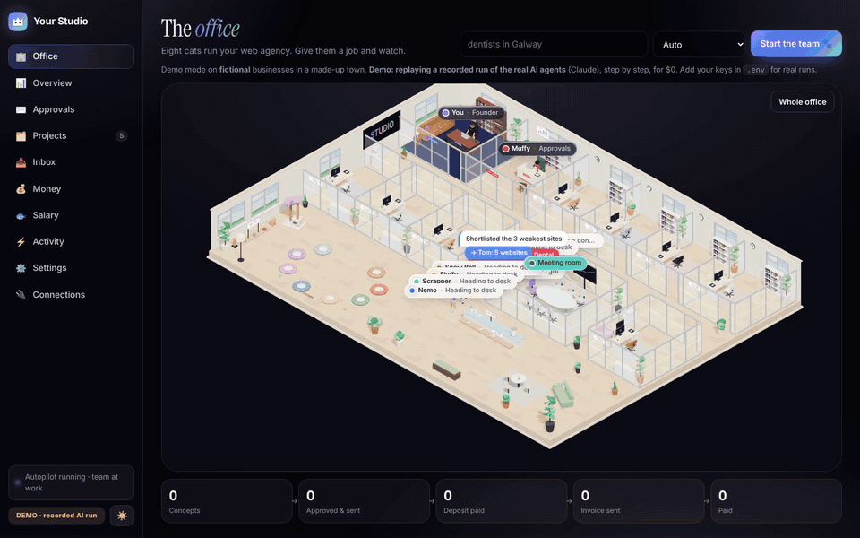

> **Live demo:** _coming soon_ (link placeholder) · Built by Hanan ([@xyzhani](https://x.com/xyzhani)) at [Siteo](https://siteostudio.com), with Claude Code · MIT licence
>
> The hosted demo runs the real pipeline on fictional sample data and replays a recorded run of the real AI agents (live searches and AI calls are switched off there; PayPal **Sandbox** payments are real Sandbox calls). Run your own copy with your keys for real searches. It's on Render's free plan, so the first visit after a quiet spell can take 30–60 seconds while the office wakes up.

<sub>Every business, person and address you see in these images is fictional. The agents are replaying a recorded run of the real Claude agents. A longer clip: [docs/media/office-demo.mp4](docs/media/office-demo.mp4).</sub>

## What it is

A small web studio in a box. You give it a kind of business and a town; eight AI agents, each a cat with one job, do the work a freelancer usually does by hand, and you stay in charge of everything that goes out. The office isn't decoration: every cat's position, every folder and every speech bubble comes from the real pipeline state.

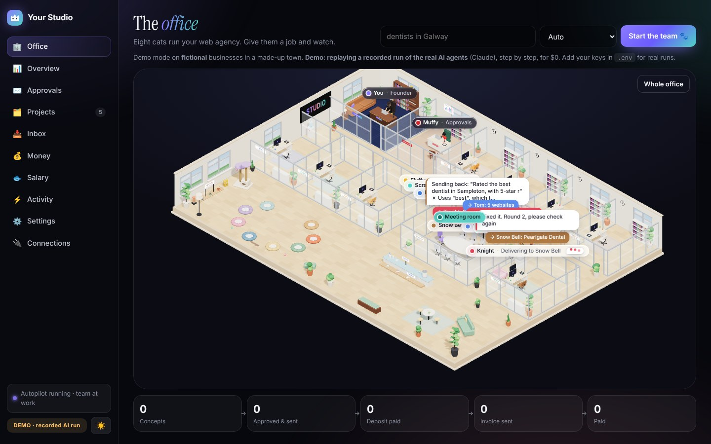

<sub>Mid-run: Snow Bell has just caught an unsupported claim and is walking the draft back to Knight.</sub>

## How the cats work

**Misso** finds businesses with a website → **Tom** audits each site and keeps the weakest → **Knight** builds a concept from their real facts → **Snow Bell** fact-checks every line → **Sherlock** notes what the old site misses → **Nemo** writes the email and waits for you → **Scrapper** reads the reply and sends a PayPal deposit link → **Fluffy** invoices the balance with PayPal and follows up.

| Cat | Role | What it does |
|---|---|---|
| **Misso** | Lead Finder | Finds businesses of that type in that town that have a website (OpenStreetMap free by default; Google Places or Apify with your key). |
| **Tom** | Site Auditor | Reads each site, runs Google PageSpeed (mobile), scores how weak it is, shortlists the weakest, extracts the real facts. |
| **Knight** | Web Developer | Builds a one-page concept site **only from those facts**, using the niche pack's template. |
| **Snow Bell** | Fact Checker | Checks every line against the facts and the niche rules. Sends it back to Knight (you see her walk the folder back), max 3 rounds, then it's set aside. |
| **Sherlock** | SEO Expert | A short note on what the old site misses. |
| **Nemo** | Email Writer | Writes the email, then **stops** in the approval inbox. Nothing is sent until a human approves. |
| **Scrapper** | Inbox & Deposits | Reads the reply. "Yes, I want it" → a **PayPal Checkout** link for the deposit (20% by default). |
| **Fluffy** | Invoices & Follow-ups | When PayPal confirms the deposit, creates a **PayPal Invoice** for the balance as an agent tool call, and drafts polite reminders until it's paid. |

Full details: [how it works](docs/how-it-works.md).

Every business gets a project page: Tom's measured issues, the facts Knight may use, Snow Bell's rounds, Sherlock's note, the emails and the payments.

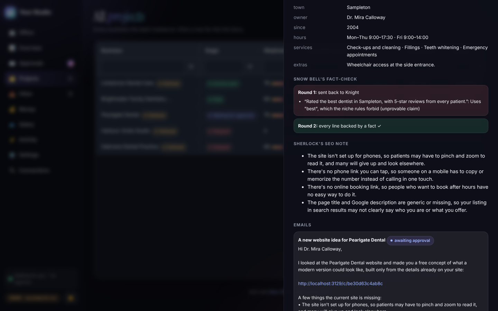

## The fact-check loop

AI-written sales copy loves to invent things: "the best dentist in town", "5-star reviews", prices nobody quoted. Snow Bell checks every line twice: a strict rule check (forbidden phrases from the niche pack, and any number, email or link that isn't in the facts) and an AI check ("which fact proves this?"). Anything unsupported goes back to Knight with the reason, up to three rounds; a concept that still fails is set aside, never sent. In Siteo's own use, 71 of 199 drafts were sent back.

## What the business owner gets

A one-page concept of their own site, built only from details already on it, clearly marked as a concept preview. Two niche packs ship: **dental practices** and **freight & logistics firms** (the logistics template has a small three.js container-yard hero).


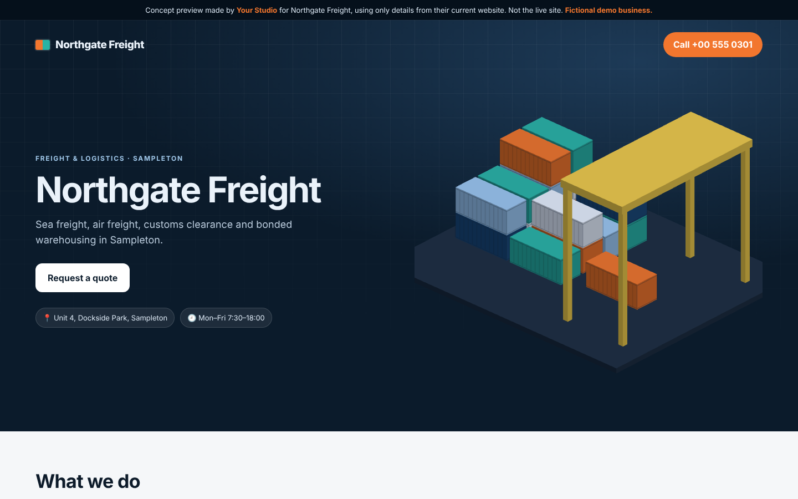

<p align="center">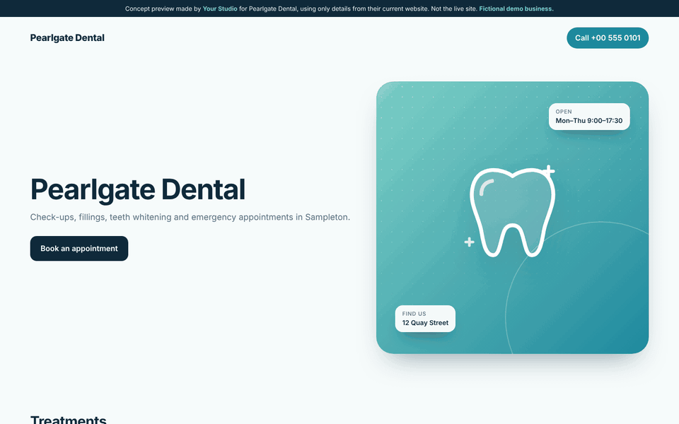 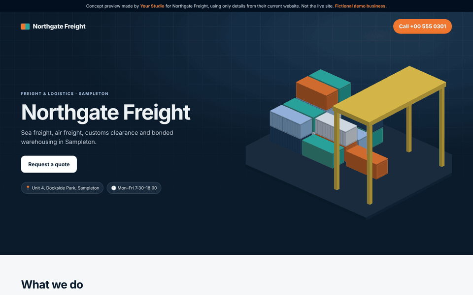</p>

<sub>Every line on these pages comes from the business's own website. A new niche is a folder of text files and one HTML template ([niche packs](docs/niche-packs.md)).</sub>

## Getting paid with PayPal

When the owner says yes, Scrapper creates a **PayPal Orders v2** checkout for the deposit. When PayPal confirms the capture (return URL or signature-verified webhook, always re-checked against the API), there's a 💰 moment in the office and Fluffy calls `create_invoice` → `send_invoice` to bill the balance with **PayPal Invoicing v2**, then tracks it until it's paid. The Money page follows along live.

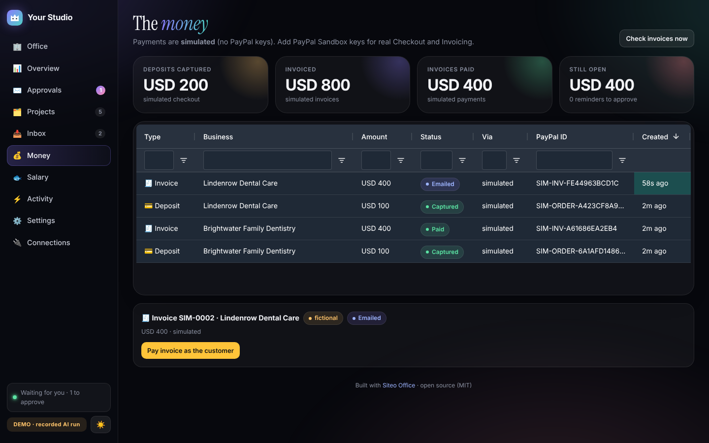

## The customer's side

A human approves every email first:

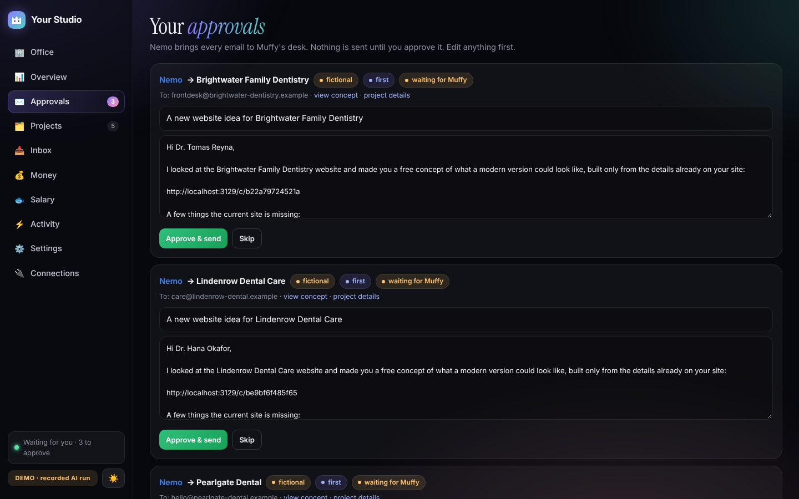

The pitch the owner receives, and the deposit email after they say yes:

<p align="center">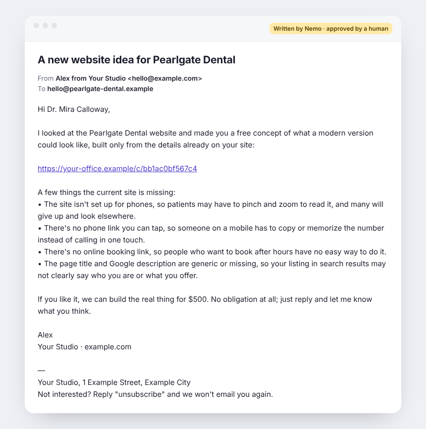 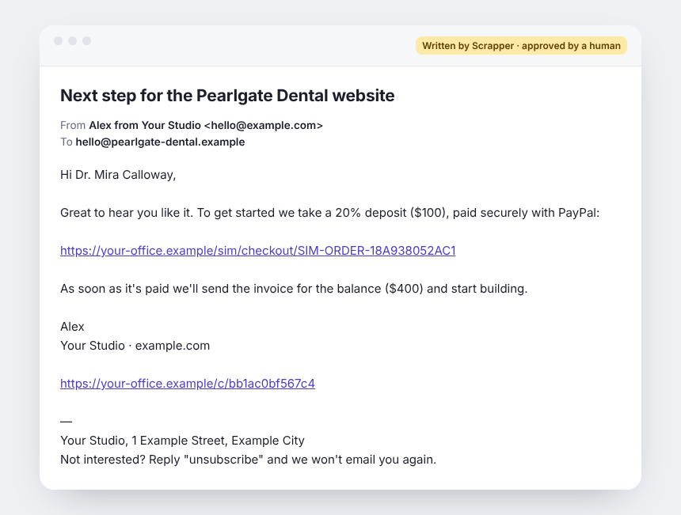</p>

The deposit step and Fluffy's invoice for the balance (shown here in keyless demo mode; with PayPal **Sandbox** keys these are PayPal's own Checkout and invoice pages, paid with a sandbox test buyer):

<p align="center">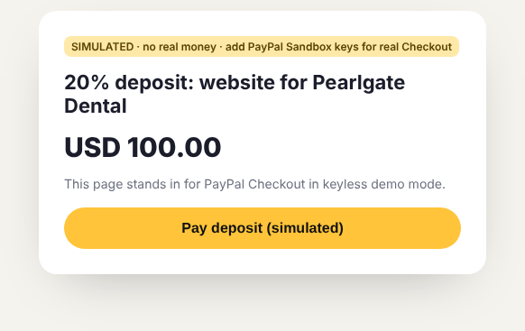 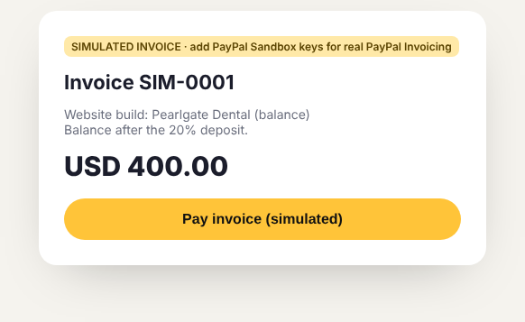</p>

## Themes & phone

Dark by default, light with one click, and it works on a phone.

<p align="center">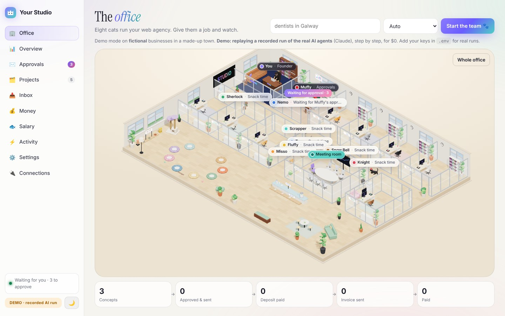 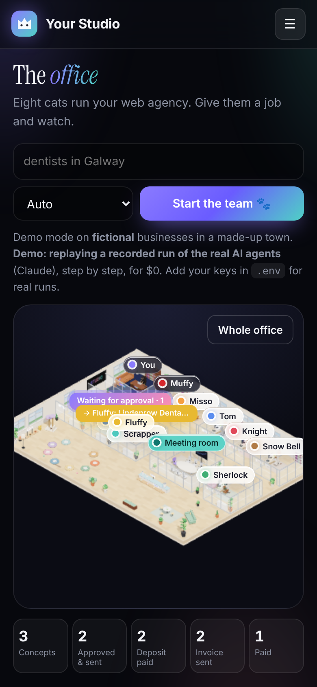</p>

---

## Try it

| Way | Time | What you need |
|---|---|---|
| **1. Try the demo** | 1 click | Nothing. Open the live demo and press **Start the team**. It runs on clearly labelled **fictional** businesses and replays a recorded run of the real AI agents. |
| **2. Deploy to Render** | ~3 min | A free Render account. [](https://render.com/deploy?repo=https://github.com/xyzhani/siteo-office) (see [deployment](docs/deployment.md)) |
| **3. Run it locally** | ~2 min | Node 20.12+ |

```bash
git clone https://github.com/xyzhani/siteo-office.git
cd siteo-office
npm install
cp .env.example .env      # leave it empty for demo mode
npm run dev               # → http://localhost:3000
```

With an empty `.env` you get **demo mode**: fictional businesses in a made-up town, the agents **replaying a recorded run of the real Claude agents** (from `demo/recorded/`, $0, no key), and a clearly marked simulated checkout. Without a recording, the agents fall back to simple rule-based paths. Add PayPal **Sandbox** keys and the deposit and invoice become real Sandbox payments. Add a Claude key and the agents write with AI on real businesses.

## Why it matters

Small studios and freelancers spend most of their time *finding* work, not doing it, and many small businesses still have websites that don't work on a phone. Siteo Office does the finding, the honest first draft and the getting-paid, while a human stays in charge of every email.

It comes from real use. Running this approach for Siteo's own studio: **650 businesses found, 125 concepts built, 199 fact checks with 71 drafts sent back for fixes, about $17 of AI in total.**

## What you get

- A live 3D office (three.js, fully procedural, no external assets) driven by the real pipeline state, mobile friendly.
- The full pipeline: find → audit → concept → fact-check loop → SEO note → email + approval → reply → PayPal deposit → PayPal invoice → follow-ups.
- A Siteo-style dashboard with a dark/light switch: Office, Overview, Approvals, Projects, Inbox, Money, **Salary** (AI cost per cat), Activity, Settings and Connections. The funnel goes concepts → approved → deposit paid → invoice sent → paid, sortable and filterable **Projects** and **Payments** tables (AG Grid) that update live as PayPal confirms payments, plus approvals, a test inbox and an activity feed.
- A [Postman collection](postman/) for the API and the PayPal deposit / invoice / webhook flow.
- **Make it yours:** rename and recolour the studio and the cats ([configuration](docs/configuration.md)), add your own niche ([niche packs](docs/niche-packs.md), dental and logistics included), and edit each agent's instructions in plain text ([teaching your agents](docs/teaching-agents.md)).
- **Swap providers:** LLM, business search, email and payments are small adapters ([providers](docs/providers.md)).

## What you need

| Key | Needed for | Required? | Where |
|---|---|---|---|
| _nothing_ | Demo mode | – | – |
| `PAYPAL_CLIENT_ID`, `PAYPAL_CLIENT_SECRET` | Real PayPal Sandbox deposits + invoices | Recommended | [developer.paypal.com](https://developer.paypal.com) → Apps & Credentials → Sandbox ([guide](docs/paypal.md)) |
| `PAYPAL_WEBHOOK_ID` | Verifying PayPal webhooks | Optional (needs a public URL) | Your PayPal app → Webhooks |
| `ANTHROPIC_API_KEY` + `CLAUDE_MODEL` | AI agents on real businesses (live mode) | For live mode | [console.anthropic.com](https://console.anthropic.com) |
| `GOOGLE_PLACES_API_KEY` | Google Places search instead of OpenStreetMap | Optional | Google Cloud console |
| `APIFY_TOKEN` | Apify Google Maps actor instead of OpenStreetMap | Optional | apify.com |
| `PAGESPEED_API_KEY` | Higher PageSpeed quota | Optional | Google Cloud console |
| `SMTP_*` | Real email instead of the test inbox | Optional | Your mail provider |

Every setting is listed in [`.env.example`](.env.example) and [deployment](docs/deployment.md).

## What it costs

- Demo mode: **$0**.
- PayPal Sandbox: **$0** (test money). OpenStreetMap and PageSpeed: free at low volume.
- AI: in Siteo's own production use, about **125 concepts cost about $17 in total**, so roughly **$0.10–0.15 per business** that gets a concept. Your cost depends on your model and settings. A per-run cap (`MAX_AI_USD_PER_RUN`, default $2) stops a run before it spends more.

## Safety and the law

- **A human approves every email.** Agents only draft.
- Every email has an **unsubscribe line**, and "unsubscribe" replies are honoured automatically.
- **Official APIs only** (OpenStreetMap, Google Places, Apify, PageSpeed, PayPal). No scraping of search results.
- Concepts only use facts from the business's own website; Snow Bell blocks invented claims, reviews and prices.
- A per-run **AI cost cap**.
- **You are responsible for following the email and privacy laws in your country** (for example CAN-SPAM, GDPR/PECR, CASL) before you contact anyone. Read [safety](docs/safety.md).

## Tools used

| Tool | How it's used |
|---|---|
| **Claude** (Anthropic API, model set by `CLAUDE_MODEL`) | Tom extracts facts from websites; Knight writes concept copy from those facts only; Snow Bell's AI fact-check (on top of rule checks); Sherlock's SEO note; Nemo, Scrapper and Fluffy write emails in the niche's tone; Scrapper classifies replies; Fluffy calls invoice tools (tool use). In demo mode, a recorded real run is replayed (`npm run record-demo`); with no recording, rule-based paths. |
| **PayPal Orders v2** (Checkout) | Scrapper's deposit link; captured on return or webhook. |
| **PayPal Invoicing v2** | Fluffy creates and sends the balance invoice, tracks its status, and reminders link to it. |
| **PayPal Webhooks** | `CHECKOUT.ORDER.APPROVED`, `PAYMENT.CAPTURE.COMPLETED`, `INVOICING.INVOICE.PAID`, signature-verified and re-checked against the API. |
| **PayPal Agent Toolkit** (optional) | With `PAYPAL_AGENT_TOOLKIT=true`, the official toolkit runs Fluffy's `create_invoice` / `send_invoice` / `get_invoice` tools (live mode). |
| **AG Grid Community** | The Projects and Payments tables (sorting, filtering, quick search, status cells, live updates). |
| **three.js** (0.160.0) | The procedural 3D cat office. |
| **OpenStreetMap** (Nominatim + Overpass) | Default business search (Google Places or Apify optional). |
| **Google PageSpeed Insights** | Tom's mobile speed check. |
| **Render** | One-click hosting (`render.yaml`). |
| **Playwright** | End-to-end screenshots at phone and desktop sizes. |

## Docs

[Getting started](docs/getting-started.md) · [How it works](docs/how-it-works.md) · [Configuration](docs/configuration.md) · [Niche packs](docs/niche-packs.md) · [Teaching agents](docs/teaching-agents.md) · [Providers](docs/providers.md) · [PayPal](docs/paypal.md) · [Deployment](docs/deployment.md) · [Safety](docs/safety.md) · [FAQ](docs/faq.md) · [Contributing](docs/contributing.md)

## Credits

Built by Hanan ([@xyzhani](https://x.com/xyzhani)) at [Siteo](https://siteostudio.com), with Claude Code. Siteo is the studio that runs these cats for real. Concept pages show a small "Built with Siteo Office" credit by default; you can switch it off in `studio.config.json` (we'd love it if you kept it).

MIT licence. The demo businesses, people and town are fictional.

## Made by

Built by Hanan at [Siteo](https://siteostudio.com), an AI-run web studio.
Website: [siteostudio.com](https://siteostudio.com) · X: [@xyzhani](https://x.com/xyzhani) · LinkedIn: [Siteo](https://www.linkedin.com/company/siteostudio)

