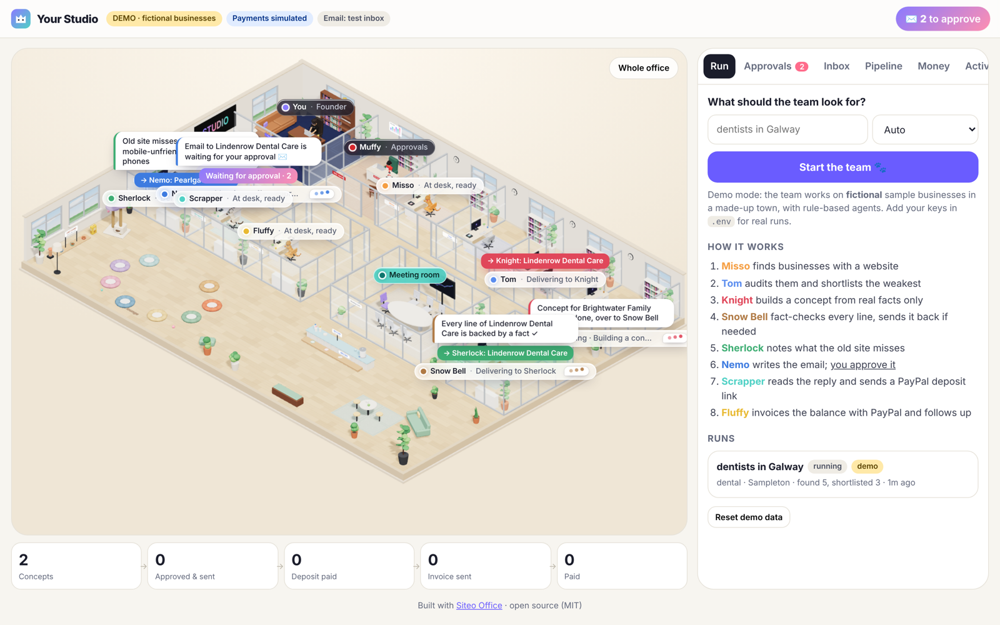
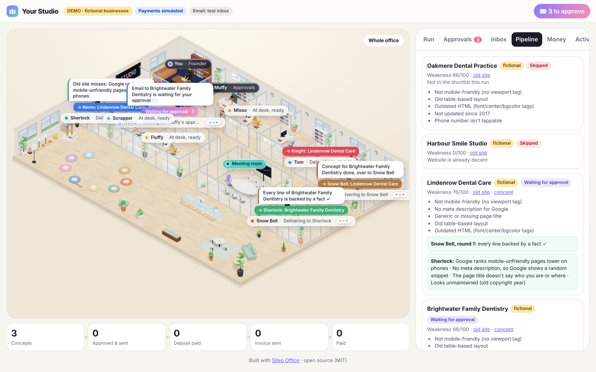

# Siteo Office 🐾

**An open-source AI web agency run by 8 cat agents in a live 3D office.**

Type one line, like `dentists in Galway`. The team finds local businesses with weak websites, builds each one a fact-checked concept site, writes the email (you approve it), reads the reply, takes a deposit with **PayPal Checkout** and invoices the balance with **PayPal Invoicing**. You watch every step happen in a cozy isometric office: cats at their desks, folders carried to the next desk, speech bubbles, a draft sent back for fixes, and a 💰 moment when PayPal confirms the money.



> **Live demo:** _coming soon_ (link placeholder) · **Built by [Siteo](https://siteostudio.com)** · MIT licence

---

## Try it

| Way | Time | What you need |
|---|---|---|
| **1. Try the demo** | 1 click | Nothing. Open the live demo and press **Start the team**. It runs on clearly labelled **fictional** businesses. |
| **2. Deploy to Render** | ~3 min | A free Render account. [](https://render.com/deploy?repo=https://github.com/<you>/siteo-office) (see [deployment](docs/deployment.md)) |
| **3. Run it locally** | ~2 min | Node 20.12+ |

```bash
git clone https://github.com/<you>/siteo-office.git
cd siteo-office
npm install
cp .env.example .env      # leave it empty for demo mode
npm run dev               # → http://localhost:3000
```

With an empty `.env` you get **demo mode**: fictional businesses in a made-up town, rule-based agents (no AI key) and a clearly marked simulated checkout. Add PayPal **Sandbox** keys and the deposit and invoice become real Sandbox payments. Add a Claude key and the agents write with AI on real businesses.

## The team

| Cat | Role | What it does |
|---|---|---|
| **Misso** | Lead Finder | Finds businesses of that type in that town that have a website (OpenStreetMap free by default; Google Places or Apify with your key). |
| **Tom** | Site Auditor | Reads each site, runs Google PageSpeed (mobile), scores how weak it is, shortlists the weakest, extracts the real facts. |
| **Knight** | Web Developer | Builds a one-page concept site **only from those facts**, using the niche pack's template. |
| **Snow Bell** | Fact Checker | Checks every line against the facts and the niche rules. Sends it back to Knight (you see her walk the folder back), max 3 rounds, then it's set aside. |
| **Sherlock** | SEO Expert | A short note on what the old site misses. |
| **Nemo** | Email Writer | Writes the email, then **stops** in the approval inbox. Nothing is sent until a human approves. |
| **Scrapper** | Inbox & Deposits | Reads the reply. "Yes, I want it" → a **PayPal Checkout** link for the deposit (20% by default). |
| **Fluffy** | Invoices & Follow-ups | When PayPal confirms the deposit, creates a **PayPal Invoice** for the balance as an agent tool call, and drafts polite reminders until it's paid. |

Full details: [how it works](docs/how-it-works.md).



## What you get

- A live 3D office (three.js, fully procedural, no external assets) driven by the real pipeline state, mobile friendly.
- The full pipeline: find → audit → concept → fact-check loop → SEO note → email + approval → reply → PayPal deposit → PayPal invoice → follow-ups.
- A dashboard: concepts → approved → deposit paid → invoice sent → paid, plus approvals, a test inbox, payments and an activity feed.
- **Make it yours:** rename and recolour the studio and the cats ([configuration](docs/configuration.md)), add your own niche ([niche packs](docs/niche-packs.md), dental and restaurants included), and edit each agent's instructions in plain text ([teaching your agents](docs/teaching-agents.md)).
- **Swap providers:** LLM, business search, email and payments are small adapters ([providers](docs/providers.md)).

## What you need

| Key | Needed for | Required? | Where |
|---|---|---|---|
| _nothing_ | Demo mode | – | – |
| `PAYPAL_CLIENT_ID`, `PAYPAL_CLIENT_SECRET` | Real PayPal Sandbox deposits + invoices | Recommended | [developer.paypal.com](https://developer.paypal.com) → Apps & Credentials → Sandbox ([guide](docs/paypal.md)) |
| `PAYPAL_WEBHOOK_ID` | Verifying PayPal webhooks | Optional (needs a public URL) | Your PayPal app → Webhooks |
| `ANTHROPIC_API_KEY` + `CLAUDE_MODEL` | AI agents on real businesses (live mode) | For live mode | [console.anthropic.com](https://console.anthropic.com) |
| `GOOGLE_PLACES_API_KEY` | Google Places search instead of OpenStreetMap | Optional | Google Cloud console |
| `APIFY_TOKEN` | Apify Google Maps actor instead of OpenStreetMap | Optional | apify.com |
| `PAGESPEED_API_KEY` | Higher PageSpeed quota | Optional | Google Cloud console |
| `SMTP_*` | Real email instead of the test inbox | Optional | Your mail provider |

Every setting is listed in [`.env.example`](.env.example) and [deployment](docs/deployment.md).

## What it costs

- Demo mode: **$0**.
- PayPal Sandbox: **$0** (test money). OpenStreetMap and PageSpeed: free at low volume.
- AI: in Siteo's own production use, about **125 concepts cost about $17 in total**, so roughly **$0.10–0.15 per business** that gets a concept. Your cost depends on your model and settings. A per-run cap (`MAX_AI_USD_PER_RUN`, default $2) stops a run before it spends more.

## Safety and the law

- **A human approves every email.** Agents only draft.
- Every email has an **unsubscribe line**, and "unsubscribe" replies are honoured automatically.
- **Official APIs only** (OpenStreetMap, Google Places, Apify, PageSpeed, PayPal). No scraping of search results.
- Concepts only use facts from the business's own website; Snow Bell blocks invented claims, reviews and prices.
- A per-run **AI cost cap**.
- **You are responsible for following the email and privacy laws in your country** (for example CAN-SPAM, GDPR/PECR, CASL) before you contact anyone. Read [safety](docs/safety.md).

## Docs

[Getting started](docs/getting-started.md) · [How it works](docs/how-it-works.md) · [Configuration](docs/configuration.md) · [Niche packs](docs/niche-packs.md) · [Teaching agents](docs/teaching-agents.md) · [Providers](docs/providers.md) · [PayPal](docs/paypal.md) · [Deployment](docs/deployment.md) · [Safety](docs/safety.md) · [FAQ](docs/faq.md) · [Contributing](docs/contributing.md)

## Credits

Built by **[Siteo](https://siteostudio.com)**, the studio that runs these cats for real. Concept pages show a small "Built with Siteo Office" credit by default; you can switch it off in `studio.config.json` (we'd love it if you kept it).

MIT licence. The demo businesses, people and town are fictional.
